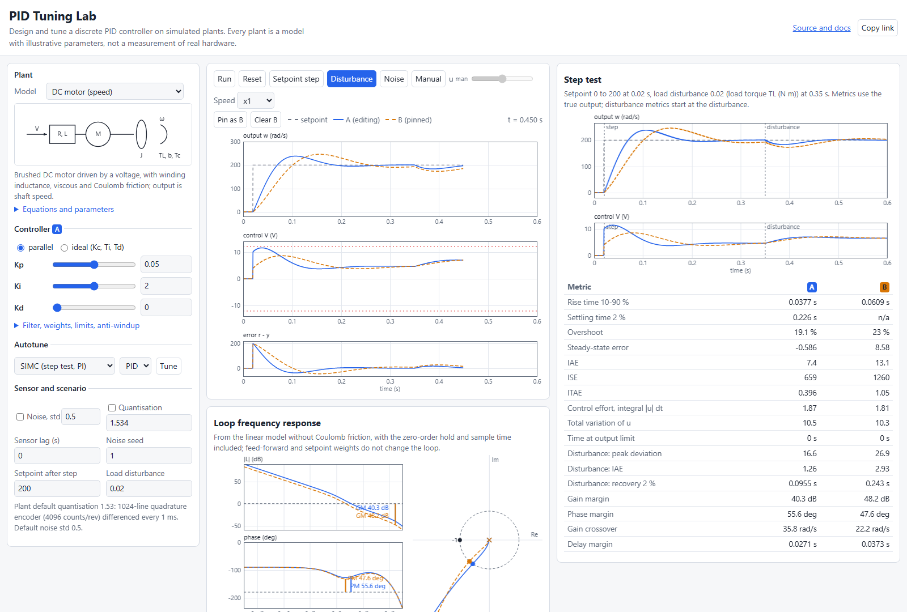
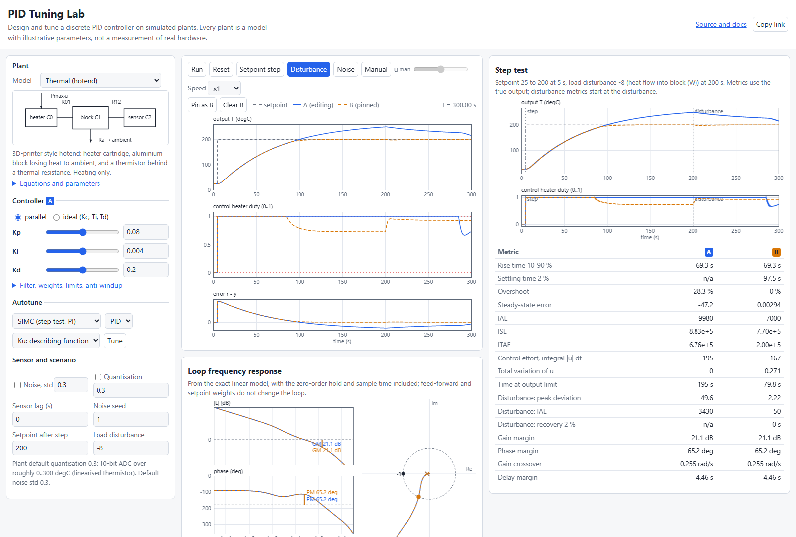

# PID Tuning Lab

[](https://github.com/projectbin07-stack/pid-tuning-lab/actions/workflows/ci.yml)
[](LICENSE)

An interactive browser lab for designing and tuning discrete PID controllers
on simulated plants: a DC motor, a 3D-printer hotend, a mass-spring-damper, an
integrating axis, a nonlinear robot arm joint and the classic first-order plus
dead time process. Change a gain and watch the live strip charts, the
step-response metrics and the Bode and Nyquist margins move together.

**Live demo: https://projectbin07-stack.github.io/pid-tuning-lab/**

> **Everything here is simulated.** The plants are textbook models with
> illustrative parameters. They are not measurements of, or fits to, any real
> motor, heater or mechanism, and nothing in this repository has been run on
> hardware. Gains from this lab are a starting point for a real system, not a
> substitute for testing on it.



## Why

Firmware PID loops are usually tuned on the bench by trial and error, and the
effects that make tuning hard (actuator saturation and windup, derivative
noise, encoder quantisation, sample time, dead time) are easy to describe and
hard to see. This lab puts them side by side with the same discrete
controller structure you would write in C: setpoint weighting, filtered
derivative on measurement, anti-windup, output and rate limits, bumpless
manual/auto transfer. The same code runs headless from a CLI for scripted,
reproducible numbers.

## Features

- **Six plant models** with documented equations and parameters
  ([docs/models.md](docs/models.md)): FOPDT, underdamped mass-spring-damper,
  DC motor (electrical and mechanical states, voltage limit, Coulomb
  friction), integrating position axis, three-node hotend thermal model, and a
  nonlinear single-link arm in gravity.
- **Simulation**: fixed-step RK4 with sub-stepping, dead time through a delay
  buffer, controller sample time separate from the plant step, zero-order
  hold.
- **Controller**: parallel or ideal form; derivative filter N; setpoint
  weights b and c; output limits; anti-windup by clamping or back-calculation
  (tracking time Tt); rate limit; bumpless manual/auto transfer and bumpless
  gain changes; optional static feed-forward.
- **Disturbances and sensors**: load disturbance step, seeded measurement
  noise, quantisation (encoder counts, ADC bits), first-order sensor lag.
- **Tuning**: open-loop step test with two-point and least-squares FOPDT
  identification, then SIMC, Cohen-Coon or Ziegler-Nichols reaction-curve
  rules; Astrom-Hagglund relay autotune with Ziegler-Nichols or
  Tyreus-Luyben rules. Every relay test goes through a general validity
  check: is the oscillation set by the plant or by the controller's sampling
  delay? Ku is given both from the describing function and from the first
  Fourier harmonic. Warnings when an experiment does not fit the rule's
  assumptions.
- **Metrics**: rise time, settling time, overshoot, steady-state error,
  IAE/ISE/ITAE, control effort, total variation of u, saturation time,
  disturbance peak/IAE/recovery, and gain, phase and delay margins from the
  loop frequency response (sample-and-hold included).
- **App**: live strip charts (output, control, error), plant schematics,
  sliders and numeric inputs, step/disturbance/noise/manual buttons, compare
  mode overlaying a pinned controller B, Bode and Nyquist plots with margin
  markers, shareable URLs, keyboard shortcuts, phone-width layout, light and
  dark themes. No external assets, no runtime dependencies, no build step.
- **CLI** with `run`, `tune` and `plants`, text or JSON output, CSV traces,
  deterministic for a seed.

## Quick start

In the browser: open the [live demo](https://projectbin07-stack.github.io/pid-tuning-lab/).
It starts on the FOPDT plant and plays a setpoint step followed by a load
disturbance. Try:

1. Pick **Thermal (hotend)**, open "Filter, weights, limits, anti-windup" and
   set anti-windup to **none**: the heater saturates during the warm-up and
   the temperature overshoots by about 28 %. Press **Pin as B**, switch back
   to back-calculation, and compare.
2. On the **DC motor**, tick **Noise** and add some Kd, then lower the
   derivative filter N to see how much of the noise reaches the voltage.
3. Run **Autotune** with "Ziegler-Nichols relay" on the motor (or the
   mass-spring-damper, integrating axis or arm) and read why the validity
   check fails. Then try it on the thermal or FOPDT plant, where a relay test
   is meaningful, and compare the two Ku estimates.

The thermal example as a link:
[`?plant=thermal&aw=none&compare=1&run=6000&paused=1`](https://projectbin07-stack.github.io/pid-tuning-lab/?plant=thermal&aw=none&compare=1&run=6000&paused=1)
(A without anti-windup, B with back-calculation):



URL parameters: `plant`, every controller setting (`kp`, `ki`, `kd`,
`form=ideal` with `kc`, `ti`, `td`, `n`, `b`, `c`, `umin`, `umax`,
`aw`, `tt`, `rate`, `ts`, `ff`), sensor and scenario (`noise`, `quant`,
`lag`, `seed`, `sp`, `dist`), plant parameters as `p.<name>`, the comparison
as `compare=1` plus `B.`-prefixed settings, `run` (plant steps to simulate
before the first frame) and `paused=1`. **Copy link** copies the current
setup.

Keyboard: <kbd>Space</kbd> pause, <kbd>R</kbd> reset, <kbd>S</kbd> setpoint
step, <kbd>D</kbd> disturbance, <kbd>N</kbd> noise, <kbd>M</kbd> manual/auto,
<kbd>P</kbd> pin as B. All controls are reachable with Tab.

Locally (Node 22 or newer):

```bash
git clone https://github.com/projectbin07-stack/pid-tuning-lab.git
cd pid-tuning-lab
npm ci                 # dev tools only
npm run serve          # then open http://127.0.0.1:8000/
```

Any static file server works; the page cannot be opened from `file://`
because browsers do not load ES modules from there.

### CLI

A run with the motor's default gains:

```
$ node bin/pid-tuning-lab.js run --plant motor --kp 0.05 --ki 2 --kd 0
plant        DC motor (speed) (motor)
controller   Kp 0.05  Ki 2  Kd 0   (ideal: Kc 0.05, Ti 0.025 s, Td 0 s)
             N 10, b 1, c 0, sample time 0.001 s, limits [-12, 12], anti-windup backcalc
sensor       noise 0, quantisation 0, lag 0 s, seed 1
scenario     setpoint 0 -> 200 at 0.02 s, disturbance 0.02 at 0.35 s, 0.6 s
step response
  rise time 10-90 %     0.03768 s
  settling time 2 %     0.2258 s
  overshoot             19.1 %
  steady-state error    -0.5864
  IAE / ISE / ITAE      7.4 / 658.6 / 0.3959
  effort integral |u|   1.873
  total variation of u  10.45
  time saturated        0 s
load disturbance
  peak deviation        16.55
  IAE                   1.258
  recovery time 2 %     0.0955 s
stability margins (linear model without Coulomb friction)
  gain margin           40.3 dB at 1703 rad/s
  phase margin          55.6 deg at 35.81 rad/s
  delay margin          0.02711 s
```

Tuning the FOPDT plant with SIMC (the step test identifies K = 2, tau = 5 s,
theta = 1.02 s against the true 2, 5 and 1):

```
$ node bin/pid-tuning-lab.js tune --plant fopdt --method simc
method       simc (PI)
FOPDT fit    least squares: K 2, tau 5 s, theta 1.02 s
             two-point:     K 2, tau 4.96 s, theta 1.039 s
plant        First order + dead time (fopdt)
controller   Kp 1.225  Ki 0.2451  Kd 0   (ideal: Kc 1.225, Ti 5 s, Td 0 s)
             N 10, b 1, c 0, sample time 0.05 s, limits [-2, 2], anti-windup backcalc
sensor       noise 0, quantisation 0, lag 0 s, seed 1
scenario     setpoint 0 -> 1 at 1 s, disturbance -0.3 at 35 s, 60 s
step response
  rise time 10-90 %     1.95 s
  settling time 2 %     6.25 s
  overshoot             4.19 %
  steady-state error    -5.80e-6
  IAE / ISE / ITAE      2.207 / 1.708 / 3.006
  effort integral |u|   18.99
  total variation of u  1.293
  time saturated        0 s
load disturbance
  peak deviation        0.1787
  IAE                   1.214
  recovery time 2 %     13.48 s
stability margins (exact linear model)
  gain margin           9.94 dB at 1.532 rad/s
  phase margin          61.2 deg at 0.488 rad/s
  delay margin          2.19 s
```

A relay test on the hotend (first lines; the evaluation follows as above).
The ultimate point of this model computed from its frequency response is
Ku = 0.322, Pu = 11.4 s, so the relay estimate is 2 % low. The validity
check passes: one extra sample of delay in the loop moves the period by only
6.9 %, so the plant sets the oscillation, not the controller's timing:

```
$ node bin/pid-tuning-lab.js tune --plant thermal --method zn-relay
method       zn-relay (PID)
relay test   Ku 0.3151, Pu 11.6 s (output amplitude 0.8081)
             Ku by describing function 0.3151, by first harmonic 0.3127; the rule uses the describing function
validity     passed: 116 samples per period, one extra sample of delay changes Pu by 6.9 %
plant        Thermal (hotend) (thermal)
controller   Kp 0.1891  Ki 0.0326  Kd 0.2742   (ideal: Kc 0.1891, Ti 5.8 s, Td 1.45 s)
```

The same test where it does not work. On the mass-spring-damper (and the
motor, integrating axis and arm) the plant alone never reaches -180 deg of
phase, so the oscillation comes from the sampling delay:

```
$ node bin/pid-tuning-lab.js tune --plant msd --method zn-relay
method       zn-relay (PID)
relay test   Ku 162.8, Pu 0.48 s (output amplitude 0.06255)
             Ku by describing function 162.8, by first harmonic 166.3; the rule uses the describing function
validity     FAILED: 48 samples per period, one extra sample of delay changes Pu by 87.5 %
warning      The relay test failed its validity check: one extra sample of loop delay changed the period by 87.5 % (at most 25.0 % allowed). The oscillation is set by the controller's sampling and loop delay rather than by the plant's own phase lag, so Ku, Pu and the Ziegler-Nichols gains derived from them are not trustworthy: they follow the sample time, not the plant, and are usually too aggressive. Use a step-test method (SIMC or Cohen-Coon) instead; it warns separately if the FOPDT fit is poor.
```

On the default FOPDT plant the test is valid, but the relay output is
nearly a triangle wave and the describing-function Ku is 19 % low. The
output says so. `--ku harmonic` uses the first-harmonic estimate instead,
which matches the sampled loop's ultimate gain (4.16) to within 0.2 %:

```
$ node bin/pid-tuning-lab.js tune --plant fopdt --method zn-relay --ku harmonic
method       zn-relay (PID)
relay test   Ku 4.164, Pu 3.8 s (output amplitude 0.3006)
             Ku by describing function 3.388, by first harmonic 4.164; the rule uses the first harmonic
validity     passed: 76 samples per period, one extra sample of delay changes Pu by 5.3 %
note         The describing-function Ku (3.388) is 19 % below the first-harmonic estimate (4.164). The relay output here is far from sinusoidal, which the describing function assumes, so expect the classic Ku to be off by about that much; the first-harmonic estimate measures the plant's gain at the oscillation frequency without that assumption. The gains use the first-harmonic estimate.
plant        First order + dead time (fopdt)
```

`--json` prints the settings, scenario, metrics and margins as JSON (non-finite
values as `null`), `--csv trace.csv` writes every sample (`t,r,y,ym,u,d`).
The output is deterministic for a given seed. Full usage:

```
$ node bin/pid-tuning-lab.js --help
pid-tuning-lab 0.1.1: discrete PID design on simulated plants

Usage:
  pid-tuning-lab plants
  pid-tuning-lab run  --plant <id> [controller, sensor and scenario options]
  pid-tuning-lab tune --plant <id> --method <method> [--type pid|pi|p] [--ku df|harmonic] [options]
  pid-tuning-lab --help | --version

run simulates a setpoint step followed by a load disturbance and prints
time-domain metrics and, from the linear(ised) model, stability margins.
tune runs the experiment the method needs on the simulated plant (an
open-loop step or a relay test), applies the tuning rule and evaluates
the result. Relay results are checked for validity (is the oscillation
set by the plant or by the controller's sampling?) and a warning explains
a failed check.

Plants: fopdt, msd, motor, integrating, thermal, arm
Methods: simc, cohen-coon, zn-step, zn-relay, tyreus-luyben

Tuning:
  --type pid|pi|p          controller type for the rule (default pid; simc is PI)
  --ku df|harmonic         relay methods: Ku from the describing function
                           (default) or from the first Fourier harmonic

Controller (defaults depend on the plant):
  --kp, --ki, --kd <x>     parallel-form gains
  --form ideal --kc <x> --ti <s> --td <s>
                           ideal form instead (Ti <= 0 turns integral off)
  --n <x>                  derivative filter, Tf = Td / N (default 10, 0 = off)
  --b <x>, --c <x>         setpoint weights (default 1 and 0)
  --umin, --umax <x>       output limits
  --aw none|clamp|backcalc anti-windup (default backcalc)
  --tt <s>                 back-calculation tracking time (default auto)
  --rate <x>               output rate limit per second (default off)
  --ts <s>                 controller sample time
  --ff <0..1>              feed-forward weight on the plant's static inverse
Sensor:
  --noise <std|default>    white measurement noise (default 0)
  --quant <step|default>   quantisation step (default 0)
  --lag <s>                first-order sensor lag (default 0)
  --seed <n>               noise seed (default 1)
Scenario and plant:
  --setpoint <x>           setpoint after the step
  --disturbance <x>        load disturbance size (0 = none)
  --param <key=value>      override a plant parameter (repeatable)
Output:
  --json                   print JSON instead of text
  --csv <file>             (run) write t,r,y,ym,u,d samples to a CSV file
```

## Models and equations

Short form; [docs/models.md](docs/models.md) has the parameters, the
discretisation details and references.

| Plant         | Equations                                                                                                                | Linear model used for margins                                                                                 |
| ------------- | ------------------------------------------------------------------------------------------------------------------------ | ------------------------------------------------------------------------------------------------------------- |
| `fopdt`       | `tau y' = -y + K (u(t - theta) + d)`                                                                                     | `K e^(-theta s) / (tau s + 1)`                                                                                |
| `msd`         | `m x'' + c x' + k x = u + d`                                                                                             | `1 / (m s^2 + c s + k)`                                                                                       |
| `motor`       | `L i' = V - R i - Ke w`, `J w' = Kt i - b w - Tc tanh(w/ws) - TL`                                                        | `Kt / ((L s + R)(J s + b) + Kt Ke)` (no Coulomb friction)                                                     |
| `integrating` | `tau v' = -v + K (u + d)`, `x' = v`                                                                                      | `K / (s (tau s + 1))`                                                                                         |
| `thermal`     | `C0 Th' = Pmax u - (Th - T1)/R01`, `C1 T1' = (Th - T1)/R01 + d - (T1 - Ta)/Ra - (T1 - T2)/R12`, `C2 T2' = (T1 - T2)/R12` | `Pmax / (A B (C1 s + g) - B/R12 - A/R01)`, `A = C2 R12 s + 1`, `B = C0 R01 s + 1`, `g = 1/Ra + 1/R12 + 1/R01` |
| `arm`         | `J q'' = tau + d - b q' - m g l sin q`, `J = m l^2 + Jm`                                                                 | linearised at the setpoint q0: `1 / (J s^2 + b s + m g l cos q0)`                                             |

The controller, sampled every `T`:

```
P[k] = Kp (b r[k] - y[k])
D[k] = Tf/(Tf+T) D[k-1] + Kd/(Tf+T) ((c r[k] - y[k]) - (c r[k-1] - y[k-1])),   Tf = Td/N
v[k] = P[k] + I[k] + D[k] + ff[k]
u[k] = rate_limit(clamp(v[k], umin, umax))
I[k+1] = I[k] + Ki T e[k] + (T/Tt)(u[k] - v[k])        back-calculation
         (clamping instead skips Ki T e[k] while u is limited and e pushes further)
```

Ideal form uses `Kp = Kc`, `Ki = Kc/Ti`, `Kd = Kc Td`. Margins use the loop
`C(e^{jwT}) * ZOH(jw) * G(jw) * sensor lag`, evaluated up to the Nyquist
frequency.

## How the tuning rules work

- **Step test + FOPDT fit.** The simulated plant gets an open-loop input step
  from rest. The **two-point method** reads the times at 28.3 % and 63.2 % of
  the final change (`tau = 1.5 (t63 - t28)`, `theta = t63 - tau`); the
  **least-squares fit** minimises the squared error of the FOPDT step
  response over the whole record and is the one used for tuning. Both are
  printed.
- **SIMC** (Skogestad): PI with `Kc = tau / (K (tauc + theta))`,
  `Ti = min(tau, 4 (tauc + theta))`, `tauc = theta`. Robust, model-based,
  PI only here.
- **Cohen-Coon** and **Ziegler-Nichols reaction curve**: classic formulas
  from the same FOPDT model, aiming at quarter-amplitude decay; aggressive,
  and very high gains when `theta/tau` is small.
- **Relay autotune** (Astrom-Hagglund): the loop is closed through a relay
  of amplitude d around the operating point; the limit cycle gives
  `Pu` and `Ku = 4 d / (pi a)`. Then **Ziegler-Nichols**
  (`0.6 Ku, Pu/2, Pu/8`) or the more conservative **Tyreus-Luyben**
  (`Ku/2.2, 2.2 Pu, Pu/6.3`). Optionally, `Ku = 1/|Y1/U1|` from the
  first Fourier components of the output and relay signals (`--ku harmonic`),
  which does not assume a sinusoidal output.
- **Relay validity check**, run for every relay test on any plant. The test
  is repeated with one extra controller sample of delay. If the period
  changes by more than 25 %, the loop delay rather than the plant sets the
  oscillation. The check also requires at least 10 samples per period and a
  steady, symmetric cycle. A failed check prints a warning that says why the
  gains cannot be trusted and suggests SIMC or Cohen-Coon from a step test.
  At the default settings it passes on `fopdt` and `thermal` and fails on
  `motor`, `msd`, `integrating` and `arm`.

Known weaknesses, which the lab shows rather than hides. The describing
function makes `Ku` approximate: 2 % low on the hotend model, and 18 % low
on the default FOPDT plant, whose relay response is nearly triangular. The
output then carries a note with both estimates. A relay on a plant with at
most two lags and no dead time oscillates at a period set by the sampling,
so ZN gains from it are unusable; the validity check flags this. FOPDT fits
of oscillatory or nonlinear plants are poor. Details, derivations and
references are in [docs/models.md](docs/models.md).

## Architecture

```
index.html, styles.css      the page; loads src/ui/app.js as an ES module
src/core/                   DOM-free, deterministic, tested under Node
  plants.js       plant models, parameters, transfer functions
  integrate.js    RK4 with sub-steps, dead-time delay buffer
  pid.js          discrete PID: forms, filter, weights, anti-windup, limits, manual/auto
  sim.js          closed loop: sampling, zero-order hold, sensor chain, scenario runner
  metrics.js      step and disturbance metrics
  frequency.js    loop frequency response, gain/phase/delay margins
  tuning.js       step and relay experiments, FOPDT fits, tuning rules
  lab.js          one settings object -> simulation, metrics, margins, autotune
  rng.js          seeded random numbers
src/ui/
  state.js        URL encoding, slider mapping, formatting (tested)
  draw.js         canvas strip charts, Bode, Nyquist, schematics
  app.js          DOM wiring and the live loop (the only module that touches the page)
src/cli.js                  headless CLI (Node only, not shipped to the site)
bin/pid-tuning-lab.js       CLI entry point
scripts/serve.js            static server for local development
```

```
                 LabSettings (plant, gains, limits, sensor, scenario)
                 |                    |                         |
            makeConfig()          evaluate()                 autotune()
                 |              /         \               /           \
            Simulation    runScenario    loopMargins   step test +    relay test
             (sim.js)     + metrics.js   frequency.js  FOPDT fit      (tuning.js)
             /      \
      plants.js    pid.js
      integrate.js

  app.js (browser) and cli.js (Node) are thin layers over the same calls.
```

## Testing

```bash
npm ci
npm run format:check   # Prettier
npm run typecheck      # tsc --checkJs --strict on JSDoc types
npm run coverage       # node:test with line/branch/function thresholds
npm run check          # all three
```

The tests check behaviour against values derived independently of the code:

- FOPDT and underdamped second-order step responses against the analytic
  solutions (max deviation below 1e-9), and every plant's documented transfer
  function against a numerical linearisation of its differential equations.
- RK4 global error order 4.0 +/- 0.15.
- Anti-windup (clamping and back-calculation) cuts overshoot under
  saturation to less than half of the no-anti-windup case.
- The derivative filter cuts the control signal's total variation under
  measurement noise; bumpless manual/auto transfer and gain changes do not
  step the output.
- Relay autotune on `1/(s+1)^3` recovers Ku = 8 within 6 % and
  Pu = 2 pi / sqrt 3 within 2 %; with hysteresis it lands where the
  describing function predicts. The first-harmonic Ku equals `1/|G|` at the
  oscillation frequency within 0.5 %. On an FOPDT plant with a fast
  controller, the describing-function Ku and the period match the exact
  relay-oscillation formulas within 1 %.
- The relay validity check passes on the hotend and FOPDT plants and fails
  on the motor, mass-spring-damper, integrating axis and arm at the default
  settings. The FOPDT delay sensitivity grows with the sample time until
  the check fails. The motor's period scales with the sample time, and the
  check never passes there. Default tuning outputs of v0.1.0 are pinned by
  regression tests.
- FOPDT identification recovers known K, tau and theta, with and without
  noise.
- Margins against hand-derived values (integrator with delay, third-order
  lag, P control of an FOPDT plant).
- Determinism for a seed, URL round-trips, and the CLI's output shape and
  exit codes.

CI runs the checks on Ubuntu and Windows with Node 22 and 24, smoke-tests the
CLI, and loads the page in headless Chrome to confirm the simulation runs
and the metrics table is filled.

## Known limitations

- All plants are idealised models with made-up parameters (see the note at
  the top). The motor has smoothed Coulomb friction but no stiction, cogging,
  current limit or PWM ripple; the hotend has no thermistor nonlinearity or
  radiation; the arm is a point mass on a rigid link.
- Margins come from a continuous approximation of the sampled loop and are
  valid below the Nyquist frequency. The gain-margin search is a heuristic,
  not a Nyquist encirclement count; it is not meant for open-loop unstable
  plants (none of the built-in ones is).
- For the arm, margins are for the model linearised at the setpoint only.
- The controller computes and applies its output at the same instant; there
  is no modelled computation delay beyond the zero-order hold.
- SIMC is implemented for PI only. The step-test methods need a
  self-regulating plant and refuse the integrating one.
- Relay autotune is only meaningful on plants whose own phase reaches
  -180 deg (dead time, or three or more lags). On the motor,
  mass-spring-damper, integrating axis and arm the validity check fails and
  the gains are flagged as untrustworthy, but they are still computed and
  applied so they can be inspected. Version 0.1.0 warned only on the motor.
- The validity check's thresholds (25 % period change for one extra sample,
  10 samples per period, 5 % amplitude spread, 10 % asymmetry) are
  engineering judgement, chosen from the wide gap between passing and
  failing plants. They are not taken from a standard. The check doubles the
  relay test time.
- The describing-function Ku stays the default so that results match
  v0.1.0. It is 18 % low on the default FOPDT plant; the output notes this
  whenever it differs from the first-harmonic estimate by more than 5 %.
  Neither estimate corrects the period, which the relay's own phase error
  and the sampling delay shift by a few percent.
- The live view and the step test are separate runs: the live view reacts to
  buttons, the metrics always come from the fixed scenario.

## Roadmap

- Second-order SIMC (PID) and the integrating-process SIMC rule.
- A modelled computation delay and PWM quantisation of the actuator.
- Sensitivity function plots (|S|, |T|) and Ms.
- Exporting the tuned controller as C code with the same structure.

## License

MIT, see [LICENSE](LICENSE).
